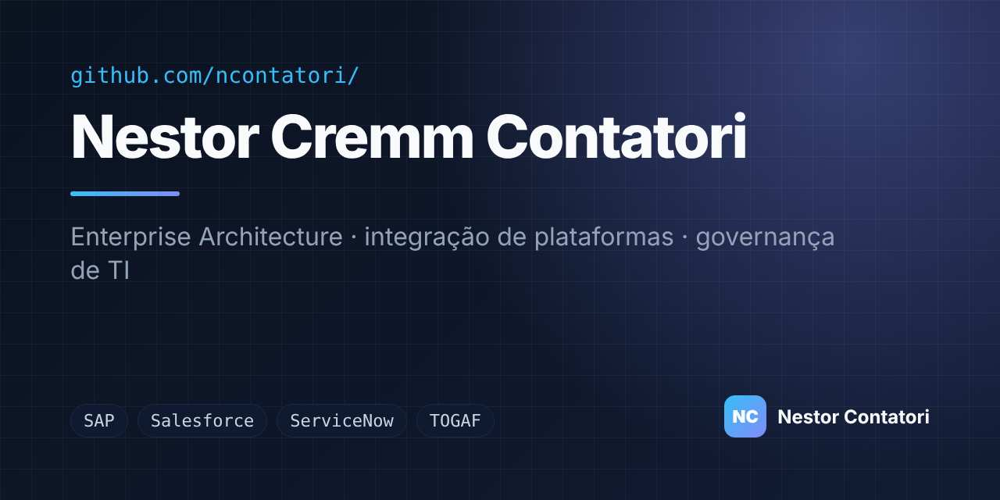

<p align="center">
  <a href="https://ncontatori.github.io"></a>
</p>

<h1 align="center">ncontatori.github.io</h1>

<p align="center">
  <strong>Site pessoal de Nestor Cremm Contatori — Enterprise Architecture</strong><br>
  <a href="https://ncontatori.github.io">ncontatori.github.io</a>
</p>

<p align="center">
  
  
  
  
</p>

## ✨ Destaques

- **Página única, sem build** — HTML, CSS e JavaScript puros
- **Tema claro/escuro** com preferência salva no navegador
- **Responsivo** e com movimento reduzido para quem prefere
- **Diagrama de arquitetura** em SVG inline, adaptado ao tema
- **Projetos automáticos** — lê os repositórios públicos pela API do GitHub
- **SEO e compartilhamento** — Open Graph, Twitter Card e JSON-LD (`Person`)

## 🗂️ Estrutura

```text
.
├── index.html        # página completa (estilos e scripts inline)
└── assets/
    ├── favicon.svg
    └── og.jpg        # imagem de compartilhamento 1280×640
```

## 🚀 Rodar localmente

```bash
git clone https://github.com/ncontatori/ncontatori.github.io.git
cd ncontatori.github.io
python3 -m http.server 8000   # abra http://localhost:8000
```

---

<p align="center"><sub>Feito por <a href="https://ncontatori.github.io">Nestor Cremm Contatori</a> · <a href="https://linkedin.com/in/nestorcontatori">LinkedIn</a></sub></p>
